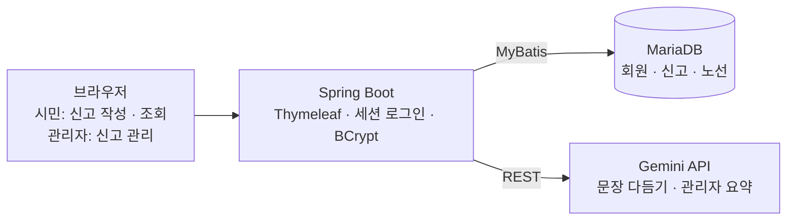
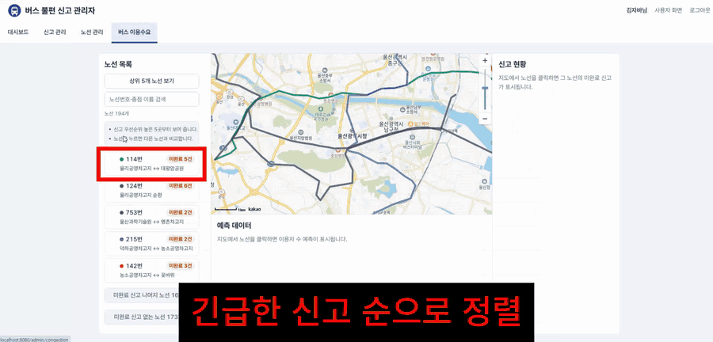

# 울산 버스 불편 신고 접수 · 처리 시스템

**신고는 쉽게, 처리는 급한 것부터.** 시민은 클릭 몇 번으로 노선별 불편을 신고하고, 관리자는 점수와 이유가 붙은 목록에서 급한 신고부터 처리합니다.


### 시민: 신고 접수 (유형 · 노선 · 예시 문장 · AI 다듬기)


## 한눈에 보기

| | |
|---|---|
| 신고 유형 순위 | 상위 4개 유형이 전체의 **72.2%** (경상일보 울산시 2025년 1~9월 자료) |
| 반복 신고 | 같은 사람이 같은 유형을 같은 주에 여러 번 신고해도 **1건**으로 집계 |
| 처리 우선순위 | 점수 = 0.4×심각도 + 0.3×이용자 규모 + 0.2×방치 + 0.1×반복 |
| 긴급 규칙 | 사고 위험 유형이거나 **14일 이상 방치**된 신고는 점수와 무관하게 맨 위 |

## 기술 스택

Java 17 · Spring Boot · MyBatis · Thymeleaf · MariaDB · BCrypt · Gemini API · FastAPI 

## 구조



## 맡은 부분

**신고 (시민)**
- 로그인/회원가입(BCrypt), 신고 작성 · 조회 · 수정 · 취소
- 접수 검증: 화면과 같은 규칙을 서버에서 다시 검사, 유형 이름은 DB 값 사용, 본인 신고 + '접수' 상태일 때만 수정·취소
- 메인 유형 순위: 같은 사람의 같은 주 반복 신고는 1건
- AI 도우미: 메모 다듬기, 유형별 예시 문장 3개 제안


**처리 (관리자)**
- 처리 우선순위: 규칙을 검증해 결함 3가지 수정 (예측 없는 노선 0점 → 중간값, 반복 신고 반영 불일치, 오래된 신고 굶김 → 14일 긴급 구간)
- AI 비서(7일 요약 · 질문): 숫자는 서버가 쓰고 해석만 Gemini가 작성, 신고 글 속 지시문은 따르지 않고 이름·전화번호는 보내지 않음
- 접근 제어: `AdminInterceptor`로 모아 화면은 리다이렉트, `/admin/api/**`는 403 JSON
- 노선 관리, 예측 노선 번호 동기화, 울산 BIS 노선 이름 가져오기


## 핵심 코드


| 주제 | 판단 | 코드 |
|---|---|---|
| 예측 없는 노선 | 0이 아니라 **중간값**. 이용자 수는 소수 노선에 몰려 있어 고정 50이면 예측 없는 노선이 절반 넘는 노선보다 앞섬 | [`RouteListService`](src/main/java/com/commit/project3/service/RouteListService.java#L128) |
| 우선순위 계산 | 노선별 건수·최근 4주 반복을 한 번에 집계해 신고 수만큼 쿼리하지 않음, 정렬 마지막 기준은 신고 번호로 동점 순서 고정 | [`ReportPriorityService`](src/main/java/com/commit/project3/service/ReportPriorityService.java#L80) |
| 반복 신고 | 같은 사람·유형·주는 1건으로 집계 | [`report.xml`](src/main/resources/mapper/report.xml#L18) |
| 순위 캐시 | 성공은 10분, 빈 순위는 30초만 기억. 시계를 주입해 기다리지 않고 테스트 | [`RouteRankService`](src/main/java/com/commit/project3/service/RouteRankService.java#L45) · [테스트](src/test/java/com/commit/project3/service/RouteRankServiceTest.java#L55) |
| AI 숫자 | 건수·평균·비율은 서버가 문장으로 작성, 같은 값이 이어지는 날은 구간으로 묶어 "가장 많은 날" 오류 방지 | [`RouteFactText`](src/main/java/com/commit/project3/service/RouteFactText.java#L13) · [`RouteFacts`](src/main/java/com/commit/project3/service/RouteFacts.java#L20) |
| AI 호출 | 키는 헤더로 보내고 로그에서 `key=***`로 가림, 연결 5초·읽기 30초 제한 | [`GeminiClient`](src/main/java/com/commit/project3/service/GeminiClient.java#L37) |
| AI 입력 | 사용자 글 속 지시문은 정리할 글로만 취급, 보완 안내는 항목 이름만 받아 서버가 문장 작성, 온도는 용도별(0.1 / 0.3 / 0.7) | [`ReportAiService`](src/main/java/com/commit/project3/service/ReportAiService.java#L25) |
| 파일 업로드 | 저장 이름을 UUID로 새로 만들고 확장자·개수·용량을 먼저 검사 | [`UploadUtil`](src/main/java/com/commit/project3/util/UploadUtil.java#L26) · [`checkFiles`](src/main/java/com/commit/project3/service/ReportService.java#L262) |
| 접수 실패 처리 | 파일 → 신고 → 파일 정보 순으로 저장하고 단계별로 되돌림 (임시 방식, 한계 참고) | [`ReportService`](src/main/java/com/commit/project3/service/ReportService.java#L133) |
| 관리자 접근 | 화면 요청은 리다이렉트, API는 403 JSON | [`AdminInterceptor`](src/main/java/com/commit/project3/config/AdminInterceptor.java#L14) |

```sql
-- 같은 사람이 같은 유형을 같은 주(월~일)에 여러 번 신고하면 1건으로 센다
COUNT(DISTINCT CONCAT_WS('|', IFNULL(R.MEMBER_NO, CONCAT('n', R.REPORT_NO)), YEARWEEK(R.REG_DATE, 1))) AS cnt
```


### 관리자: 노선별 이용자 수 예측



> 지도에서 노선을 고르면 노선 경로와 일별 · 시간대별 예상 이용자 수가 나오고, 두 노선을 비교하거나 AI에게 신고와 예측을 근거로 한 분석을 물어볼 수 있습니다.

## 기록

- [프로젝트 작업 일지 (Notion)](https://fluffy-plane-19c.notion.site/3e3a969c48278070bbaaf5dee74b31b4)
