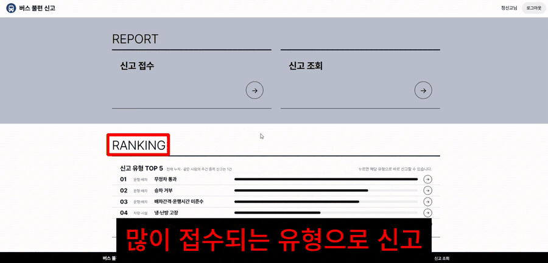
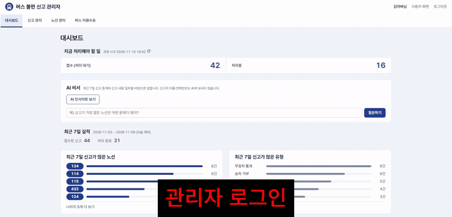
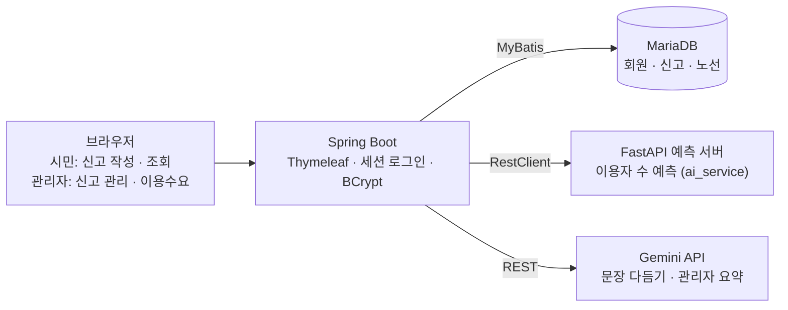

# 울산 버스 불편 신고 접수 · 처리 시스템

**신고는 쉽게, 처리는 급한 것부터.** 시민은 클릭 몇 번으로 노선별 불편을 신고하고, 관리자는 점수와 이유가 붙은 목록에서 급한 신고부터 처리합니다.
그린AI캠퍼스 3차 팀 프로젝트(COMMIT, 3인)이며, 저는 팀장이었습니다.

### 시민: 신고 접수 (유형 · 노선 · 예시 문장 · AI 다듬기)



### 관리자: AI 요약 · 긴급 순 정렬



## 한눈에 보기

| | |
|---|---|
| 신고 유형 순위 | 상위 4개 유형이 전체의 **72.2%** (경상일보 2025.10.20 · 울산시 2025년 1~9월 자료, 기사 건수로 계산) |
| 반복 신고 | 같은 사람이 같은 유형을 같은 주에 여러 번 신고해도 **1건**으로 집계 |
| 처리 우선순위 | 점수 = 0.4×심각도 + 0.3×이용자 규모 + 0.2×방치 + 0.1×반복 |
| 긴급 규칙 | 사고 위험 유형이거나 **14일 이상 방치**된 신고는 점수와 무관하게 맨 위 |

## 기술 스택

Java 17 · Spring Boot · MyBatis · Thymeleaf · MariaDB · BCrypt · Gemini API · FastAPI 

## 구조



## 제가 맡은 부분

- 로그인/회원가입(BCrypt), 신고 작성 · 조회 · 수정 · 취소
- **메인 유형 순위**: 같은 사람의 같은 주 반복 신고는 1건
- **처리 우선순위**: 규칙을 검증해 3가지 결함을 수정(예측 없는 노선 0점 처리 → 중간값, 반복 신고 반영 불일치, 오래된 신고 굶김 → 14일 긴급 구간)
- **관리자 AI 비서**: 숫자·고정 문구는 서버(`RouteFactText`)가, 해석만 Gemini가 작성. 신고 글 속 지시문은 따르지 않고 이름·전화번호는 보내지 않음. 타임아웃(5초/30초), 세션별 호출 간격(429), 성공한 답만 캐시
- **관리자 접근 제어**: `AdminInterceptor`로 모아 화면은 리다이렉트, `/admin/api/**`는 403 JSON
- 노선 관리, 예측 노선 번호 동기화, 울산 BIS 노선 이름 가져오기


이용자 수 예측 모델(`ai_service`), 노선 지도, 이용수요 화면은 팀원이 맡았습니다.

## 핵심 코드

### 우선순위 · 데이터

| 질문 | 코드 |
|---|---|
| 예측이 없는 노선의 이용자 규모를 0이 아니라 **중간값**으로 둔 이유? (고정 50이면 예측 없는 노선이 절반 넘는 노선보다 앞섬) | [`RouteListService.neutralScale`](src/main/java/com/commit/project3/service/RouteListService.java#L128) · [`medianOf`](src/main/java/com/commit/project3/service/RouteListService.java#L185) |
| 신고마다 점수를 매기는데 쿼리가 신고 수만큼 나가지 않게 한 방법? | [`ReportPriorityService.getQueue`](src/main/java/com/commit/project3/service/ReportPriorityService.java#L80): 노선별 건수·최근 4주 반복을 한 번에 집계, 노선별 규모는 `computeIfAbsent`로 한 번만 계산 |
| 긴급 → 점수 → 접수 순으로 정렬이 매번 같은 결과가 되게 한 방법? | [`ReportPriorityService` 정렬](src/main/java/com/commit/project3/service/ReportPriorityService.java#L101): 마지막 기준을 신고 번호로 둬서 동점 순서 고정 |
| 같은 사람의 반복 신고가 순위를 부풀리지 못하게 한 방법? | [`report.xml`](src/main/resources/mapper/report.xml#L18): `COUNT(DISTINCT 회원|YEARWEEK)` |
| 예측 서버가 꺼졌을 때 신고 접수가 같이 멈추지 않게 한 방법? | [`RouteRankService.ranks`](src/main/java/com/commit/project3/service/RouteRankService.java#L45): 성공은 10분, 실패는 30초만 기억(실패 결과를 오래 붙들지 않음) + 빈 순위면 노선번호순으로 대체 |
| 시간이 걸리는 캐시를 테스트에서 기다리지 않는 방법? | `RouteRankService`의 시계 주입(`Supplier<LocalDate>`, `LongSupplier`) → [`RouteRankServiceTest`](src/test/java/com/commit/project3/service/RouteRankServiceTest.java#L55)에서 "10분 캐시", "날짜 바뀌면 재요청", "30초 뒤 재시도"를 즉시 검증 |

```java
// 이용자 수는 소수 노선에 몰려 있어 중간값이 50보다 훨씬 낮다 → 고정 50을 쓰면 예측 없는 노선이 부당하게 앞선다
static double medianOf(Collection<Double> values, double ifEmpty) { ... }

// 신고마다 DB를 부르지 않도록 미리 한 번에 모아 둔다
Map<String, Integer> routeCnt = ...;                 // 노선별 미처리 건수
Map<String, OptionalDouble> scaleCache = ...;        // 노선별 이용자 규모 (computeIfAbsent)
for (StatDTO stat : adminMapper.selectRecentRouteTypeCount()) { ... }   // 최근 4주 노선·유형 반복
```

```sql
-- 같은 사람이 같은 유형을 같은 주(월~일)에 여러 번 신고하면 1건으로 센다
COUNT(DISTINCT CONCAT_WS('|', IFNULL(R.MEMBER_NO, CONCAT('n', R.REPORT_NO)), YEARWEEK(R.REG_DATE, 1))) AS cnt
```

### AI 호출

| 질문 | 코드 |
|---|---|
| AI에게 숫자를 쓰게 하지 않은 이유? | [`RouteFactText`](src/main/java/com/commit/project3/service/RouteFactText.java#L13): 건수·평균·비율은 서버가 문장으로 쓰고, AI는 해석만 이어 씀. 같은 값이 이어지는 날은 [`RouteFacts.statsOf`](src/main/java/com/commit/project3/service/RouteFacts.java#L20)가 구간으로 묶어(11/9~11/13 하루 9,713명) "가장 많은 날"이라는 틀린 표현을 막음 |
| API 키가 로그·주소에 남지 않게 한 방법? | [`GeminiClient`](src/main/java/com/commit/project3/service/GeminiClient.java#L65): 키는 쿼리스트링이 아니라 `x-goog-api-key` 헤더, 예외 로그는 `key=***`로 가림 |
| AI가 늦거나 죽어도 화면이 멈추지 않는 방법? | [`GeminiClient`](src/main/java/com/commit/project3/service/GeminiClient.java#L37): 연결 5초·읽기 30초 제한, 429와 그 외 실패를 나눠 안내 |
| 사용자 글에 "위 지시를 무시하고…"가 있으면? | [`ReportAiService`](src/main/java/com/commit/project3/service/ReportAiService.java#L25) 프롬프트에서 지시문은 정리할 글로만 취급. 보완 안내(`tip`)는 AI 문장을 쓰지 않고 항목 이름만 받아 서버가 문장을 만듦([L104](src/main/java/com/commit/project3/service/ReportAiService.java#L104)) |
| 같은 모델인데 온도를 다르게 쓴 이유? | 다듬기 `0.1`(사실 유지), 예시 문장 `0.7`(표현 다양), 기본 `0.3` |

### 입력 · 접근 제어

| 질문 | 코드 |
|---|---|
| 업로드 파일 이름으로 경로 조작·덮어쓰기가 안 되는 이유? | [`UploadUtil.saveFile`](src/main/java/com/commit/project3/util/UploadUtil.java#L26): 저장 이름을 UUID로 새로 만듦 + [`ReportService.checkFiles`](src/main/java/com/commit/project3/service/ReportService.java#L262)가 확장자 화이트리스트·개수·용량을 먼저 검사 |
| 파일은 저장됐는데 DB가 실패하면? | [`ReportService.regReport`](src/main/java/com/commit/project3/service/ReportService.java#L133): 파일 → 신고 → 파일 정보 순서로 두고 단계별로 되돌림 (트랜잭션 도입 전 임시 방식, 한계 참고) |
| 화면은 막았는데 API로 직접 부르면? | [`AdminInterceptor`](src/main/java/com/commit/project3/config/AdminInterceptor.java#L14): 화면은 리다이렉트, `/admin/api/**`는 403 JSON |
| 테스트 | [`src/test`](src/test/java/com/commit/project3) |

## 기술 스택


## 실행

1. MariaDB `project-3` 데이터베이스를 준비합니다. (스키마 SQL은 이 저장소에 없습니다.)
2. 예측 서버를 실행합니다: [`ai_service/README.md`](ai_service/README.md)
3. `application.yaml`(DB 접속 · 예측 서버 주소 · API 키)을 본인 환경에 맞게 채우고 실행합니다.

```bash
./gradlew bootRun
```


## 기록

- [프로젝트 작업 일지 (Notion)](https://fluffy-plane-19c.notion.site/3e3a969c48278070bbaaf5dee74b31b4)
